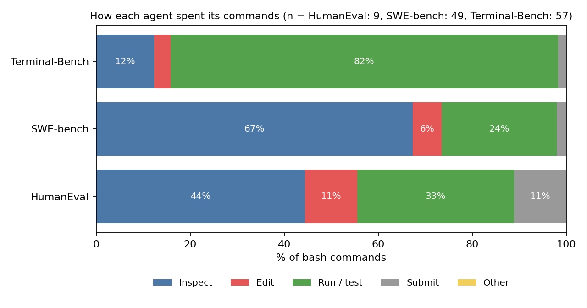
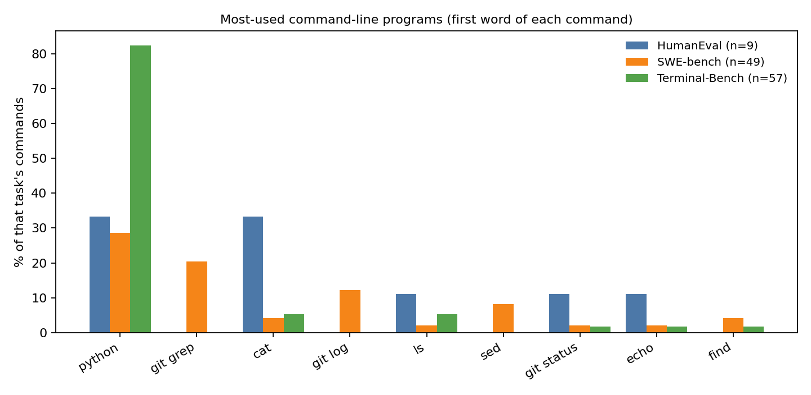
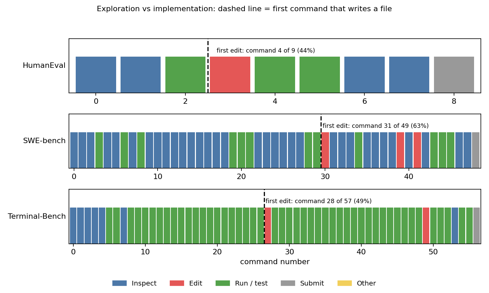

# Section 3: Run Example Tasks

## 3.1 Task 1: HumanEval

**Problem 3 (`run-example-task`)**

1. Which files are available to the agent while it works, and which files become available only during verification? Why does this separation matter?

   While it works, the agent can see the problem statement (`instruction.md`) and the starting environment built by the `Dockerfile`, which contains `/app/humaneval_0.py` with the unfinished `has_close_elements` function. The `tests/` folder (`test.sh` and `test_outputs.py`) is only brought into the container at verification time, after the agent has finished, and `solution/solve.sh` is only used by the `oracle` agent. This separation matters because an agent that could read the hidden tests or the reference solution could copy or special-case them, so a passing score would no longer show that it actually solved the problem. Keeping them apart makes the reward a measure of what the agent figured out from the instruction and the environment.

2. Run `uv run harbor run --help`. Name two agent scaffolds other than `oracle` and two environment backends other than Docker. What distinct role does each category play?

   Two agent scaffolds other than `oracle` from the `--agent` list are `claude-code` and `openhands` (others include `codex`, `aider`, `terminus-2` and `mini-swe-agent`). Two environment backends other than Docker from the `--env` list are `modal` and `daytona` (also `e2b`, `runloop` and others). The agent scaffold is the program being evaluated: it runs the loop of prompting the model, choosing tools and acting on the task. The environment backend is the infrastructure that runs the task container, for example locally in Docker or in a cloud sandbox, which affects isolation, scale and cost but not what the agent does.

3. Trace the verification process after the agent finishes: which file does Harbor execute, where do the private tests come from, and how is the final reward communicated back to Harbor?

   After the agent finishes, Harbor runs `tests/test.sh`, which is the verifier entry point. The private tests come from the task's own `tests/` folder (`test_outputs.py`), which is copied into the container at `/tests` only for verification. `test.sh` runs `python /tests/test_outputs.py`, which imports `has_close_elements` from `/app/humaneval_0.py` and asserts the expected outputs. If the tests pass, `test.sh` writes `1` to `/logs/verifier/reward.txt`, otherwise it writes `0`, and Harbor reads that file to get the final reward.

**Problem 4 (`run-example-agent`)**

1. Summarize the agent's approach. Which files and commands did it use?

   The agent first read the starting file with `cat /app/humaneval_0.py` and listed `/app` (steps 2-3), then rewrote the whole file with a heredoc (step 5). Its solution sorts the list and compares each adjacent pair against the threshold, returning `True` if any gap is smaller than `threshold`. It then checked its work with `python3 -m doctest` (step 6) and an inline script of assert statements that also added edge cases such as an empty list and a single element (step 7), re-read the file (step 9) and submitted with `echo COMPLETE_TASK_AND_SUBMIT_FINAL_OUTPUT` (step 10).

2. Identify one decision in the trajectory that helped or hurt the final result. Cite the relevant step.

   The decision that helped most was step 5: sorting the list and checking only adjacent elements is a correct and efficient way to find two numbers closer than the threshold, and it avoids the nested-loop approach. Step 7 also helped, because the agent tested its own code on the docstring examples, extra edge cases (empty list, one element) before submitting. One step that did not help was step 4, where it tried to import a `human_eval` package and ran `pip list`, apparently hoping to find the reference tests or solution; nothing was there, so it only cost a step, but it shows why the verifier's tests are kept out of the agent's container.

3. Did the verifier reward accurately reflect the quality of the agent's solution? Why or why not?

   Yes, for this task the reward of 1 accurately reflects a correct solution. The sorted-adjacent approach returns the right answer for every pair, and the hidden tests in `tests/test_outputs.py` cover both `True` and `False` cases at several thresholds, which the agent's solution passed. The reward is still a fairly weak measure, though: the verifier only has seven assertions, and the agent's step-7 asserts match those official HumanEval test cases, which suggests the problem is well known to the model and too easy to separate strong agents.

## 3.2 Task 2: SWE-bench Verified

**Problem 5 (`run-swebench-agent`)**

1. Summarize the agent's approach. How did it locate the relevant code, and what change did it make?

   The agent located the code with `find . -name "validators.py"` and read `django/contrib/auth/validators.py` (steps 2-3), found the repo's `testbed` conda environment so it could run Django's tests (steps 7-8), and reproduced the bug with a small script showing both `ASCIIUsernameValidator` and `UnicodeUsernameValidator` accept `'username\n'` (step 10). After studying how other Django validators are written, it edited both classes in `django/contrib/auth/validators.py`, changing the regex from `^[\w.@+-]+$` to `\A[\w.@+-]+\Z` (step 32), then re-ran the reproducer, added newline cases to `tests/auth_tests/test_validators.py` (steps 41-43), ran the `auth_tests` and `validators` suites (steps 45-47) and submitted.

2. Identify one point where the agent used repository context that would not exist in a self-contained HumanEval task.

   At steps 13-14 and 26 the agent used `git grep` to see how `django/core/validators.py` anchors its own regexes (`^...\Z`) and at steps 16-17 and 27-28 it read `git log -S` and `git show` history to find the earlier commit that fixed the same newline problem for other validators. This is repository context that a self-contained HumanEval function does not have: project conventions, commit history and existing tests. It also checked `deconstruct()` and the migration tests (steps 21-23) because these validators are used in migrations, something it could only know by reading the surrounding codebase.

3. Compare this trajectory with the HumanEval trajectory. What made this task more difficult to understand, modify, or verify?

   The HumanEval trajectory took 11 steps and about 23k prompt tokens in one file, while this one took 51 steps and about 1.03M prompt tokens (most of it cached), because the agent first had to find the right file in a large repository, discover that the system `python` was not the right environment, and decide how to fit the change to the project's conventions. The task is also harder to verify: correctness depends on running part of Django's real test suite in a prepared environment instead of a few asserts on one function, and a regex fix can have side effects (migrations, other validators) that the agent had to rule out by running wider suites. The issue text suggests the fix, but the agent still had to confirm it was the right one.

4. Did the final reward accurately reflect the quality of the agent's solution? Support your answer with evidence from the verifier logs.

   Yes, the reward of 1.0 matches a correct fix. `verifier/report.json` shows `resolved: true`, with all 3 FAIL_TO_PASS tests (`test_ascii_validator`, `test_unicode_validator`, `test_help_text`) and all 19 PASS_TO_PASS tests passing, and `test-stdout.txt` shows 22 tests run with the two validator tests `ok`. The verifier first runs `git checkout` on `tests/auth_tests/test_validators.py` and applies the official test patch, so the tests the agent added itself were discarded and the reward reflects only its source change. The agent's regex (`\A...\Z`) differs slightly from the reference patch (`^...\Z`) yet is also accepted, though the verifier only runs this one test file, so it would not catch regressions elsewhere in Django.

## 3.3 Task 3: Terminal-Bench 2.1

**Problem 6 (`run-terminal-bench-agent`)**

1. Summarize the agent's approach. What information did it gather, and what solution strategy did it pursue?

   The agent first looked around: it listed `/app`, read `forward.py` (a 2-layer ReLU network with 20 hidden neurons and 10 inputs), and checked which Python packages were available. It then pursued a known model-extraction strategy for piecewise-linear networks: query the network along random lines, find the points where the slope suddenly changes (a ReLU switching on or off, called a "critical point"), and use the size and direction of the gradient jump there to recover a row of `A1` up to scale. It tuned this on the true weights it could read from `forward.py`, wrote `/app/steal.py`, ran it, and saved `/app/stolen_A1.npy`.

2. Identify one point where the agent made meaningful progress and one point where its approach broke down or became unproductive.

   Progress: around steps 15-19 the agent's critical-point search recovered all 20 neuron directions when it was allowed to compare against the true `A1`, and it later confirmed the method on other random networks (steps 24-25). Breakdown: the first real `steal.py` run failed its own check at step 31 (neuron 5 matched nothing), and the agent spent steps 32-45 chasing the cause (critical points two neurons close together, tiny jumps). Its rewrite (step 51) passed its own self-check, but it used the same kind of test, and the official verifier still found 8 of 30 rows wrong. It never tested on a bigger, differently-seeded network like the one the verifier uses.

3. What evidence does the verifier provide beyond the scalar reward? Does it capture partial progress on this task?

   The verifier output includes the pytest/ctrf report and the assertion message `Failed to match rows: [5, 6, 14, 18, 26, 27, 28, 29]`. That tells us the stolen matrix matched 22 of 30 true rows, so the agent was mostly right, but reward is 0 because the test is all-or-nothing. So the reward itself does not capture partial progress; the log does. It also exposes the cause: the verifier swaps in a wider (30-neuron) network, and the agent's solution was tuned to the 20-neuron one it could see.

4. How did the open-ended terminal environment affect the agent's ability to plan, test its assumptions, and recover from mistakes?

   Being able to run arbitrary Python let the agent plan experiments, test assumptions quickly (47 of 57 commands were Python runs), and try its algorithm on other random networks, which a fixed-answer benchmark would not allow. It could also recover from errors, e.g. diagnosing neuron 5 by printing cosine similarities. The downside is that nothing forced it to test the right thing: it built its own test networks that were easy and similar to the visible one, so its confidence ("matched 20/20") was misleading, and it submitted without checking on a larger network. Open-ended freedom helps exploration but needs the agent to question its assumptions about the hidden test.

## 3.4 Analyzing Agent Trajectories

**Problem 7 (`analyze-trajectories`)**

Answer **three** of the seven questions below and **delete the other four**. For each question you answer, save the figure as a PNG in `writeup/3_run_example_tasks/` using the filename shown, then explain in 2–3 sentences what you measured, how you computed it, and what you conclude.

### `effort-distribution.png`

How did the agent distribute its effort across activities such as inspecting files, editing code, running tests, and debugging?

I classified each bash command the agent ran (by its program name and patterns such as `cat`, `sed -i`, `python`) into inspecting, editing, running/testing, and submitting, then plotted the share per task. HumanEval and SWE-bench are inspection-heavy (44% and 67%), as expected for reading code before a small fix, while Terminal-Bench is 82% running Python, since the agent worked by experiment, not by reading. This is a keyword heuristic, so a `python` command that edits a file is counted as running.

### `bash-command-usage.png`

`mini-SWE-agent` performs its work through `execute_bash`. What command-line programs and command patterns did it use across the three trajectories, and how did their use vary by task?

I counted the first program (and `git` subcommand) of every command across the three trajectories. HumanEval used almost only `cat` and `python`; SWE-bench used `git grep`, `git log`, `sed` and `git diff` to navigate a large repo; Terminal-Bench was dominated by `python` one-liners. So the toolset follows the task: code navigation in a repository, quick experiments in a research-style task.

### `exploration-to-implementation.png`

At what points did each agent appear to transition from exploring the task to implementing a solution? Define how your visualization identifies that transition.

I marked the transition as the first command that writes or edits a file (a heredoc, `sed -i`, or a redirect). It comes at command 4 of 9 for HumanEval, 31 of 49 for SWE-bench, and 28 of 57 for Terminal-Bench, so the agent explores for about half of the run or more before writing anything. For Terminal-Bench the later `steal.py` rewrite shows the agent then went back to exploring, so a single transition point is only an approximation.
